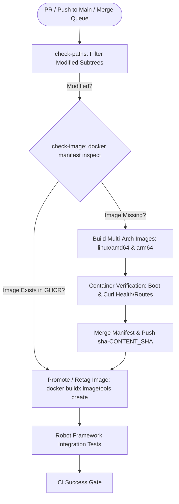

# Product Requirements Document (PRD): CI/CD Pipeline Modernization & Automated Quality Gates

## 1. Executive Summary

This PRD defines the architectural requirements, pipeline modernization, and automated verification strategy for `Mfe-shell` (Micro-Frontend Shell, MFE1, and `@polecatworks/mfe-shared`). 

Aligning with the proven enterprise CI/CD architecture established in [`sward-warden`](https://github.com/PolecatWorks/sward-warden), this initiative transitions `Mfe-shell` to:
1. **Build Once, Promote Everywhere**: Content-hash addressing and existence checks (`check-image`) with immutable digest retagging via `docker buildx imagetools`, eliminating redundant multi-arch container rebuilds between PR and Main workflows.
2. **Container Smoke Testing & Verification**: Automated local container health and HTTP contract verification prior to image promotion.
3. **Automated Robot Framework Integration Pipeline**: Executing end-to-end routing, federation remote prefix (`/mfe/<service>/remoteEntry.json`), and CORS verification in CI using ephemeral test harnesses and Robot Framework.
4. **Optimized Multi-Arch Matrix Caching**: Standardized GHA cache policies that read from `main` across all branches and only write to cache on `main`.

---

## 2. Problem Statement & Motivation

### Current Gaps in `Mfe-shell` CI/CD
1. **Redundant Rebuilds & Long Feedback Cycles**:
   - `mfe-shell-ci-pr.yml` and `mfe1-ci-pr.yml` build multi-arch (`linux/amd64` and `linux/arm64`) Docker images on PR branches.
   - Upon merge to `main`, `mfe-shell-ci-main.yml` and `mfe1-ci-main.yml` rebuild the exact same images from source despite identical component Git content SHAs.
   - This doubles runner compute time, inflates GHA cache usage, and introduces drift risk between what was tested in the PR and what is tagged on `main`.
2. **Lack of In-Pipeline Container Health Verification**:
   - Workflows only verify that Docker build completes and that `docker buildx imagetools inspect` can read the manifest metadata.
   - Neither Nginx initialization, static asset serving, runtime entrypoints (`index.html`), nor CORS headers are validated before images are pushed as deployable artifacts.
3. **Unexecuted Integration Tests**:
   - [integration-tests/tests/test_mfe_prefix.robot](../../integration-tests/tests/test_mfe_prefix.robot) defines automated tests for Shell root routes, MFE prefix paths (`/mfe/<service>/remoteEntry.json`), and CORS preflight options.
   - However, no workflow currently executes these Robot tests in CI or gates PR merges on them.

---

## 3. High-Level Architectural Solution



---

## 4. Key Requirements & Capabilities

### 4.1. Build Once, Promote Everywhere (`check-image` & Manifest Retagging)
* **Deterministic Content Hash**:
  - Compute component SHA per sub-project:
    ```bash
    COMPONENT_SHA=$(git log -1 --format=%H -- <component-folder>/ .github/workflows/<workflow>.yml)
    ```
* **Registry Query (`check-image`)**:
  - Query GitHub Container Registry via `docker manifest inspect ghcr.io/<repo>-<component>:sha-${COMPONENT_SHA}`.
  - If the manifest list already exists:
    - Mark `exists=true`.
    - Bypass matrix build steps entirely.
* **Manifest Promotion**:
  - When merging to `main` or building for a PR, if the image already exists, use:
    ```bash
    docker buildx imagetools create -t ${REGISTRY}/${IMAGE}:${TARGET_TAG} ${REGISTRY}/${IMAGE}:sha-${COMPONENT_SHA}
    ```
  - Eliminates duplicate compilation and maintains 100% cryptographic bytecode parity from PR testing to production release.

### 4.2. Container Verification & Smoke Testing
Before pushing images or promoting manifests to `main`/`pr-XXX`:
* Run a container smoke test job:
  1. Boot the built image locally in runner Docker (`docker run -d -p 8080:80 ...`).
  2. Perform HTTP probe on `/index.html` asserting `HTTP 200 OK` and `Content-Type: text/html`.
  3. Validate that Nginx starts without syntax or template substitution errors (`docker logs`).
  4. Validate CORS preflight options response (`OPTIONS /remoteEntry.json` returns appropriate headers).

### 4.3. Automated Robot Framework Integration Testing
* Implement an automated integration test workflow triggered on PRs and merge groups:
  - Spins up container dependencies (or deploys to test runner namespace).
  - Executes Robot Framework tests in `integration-tests/tests/` via `robotframework-requests`.
  - Asserts:
    - Shell serves `/index.html`.
    - Remotes are reachable under `/mfe/<service>/remoteEntry.json`.
    - CORS preflight returns `Access-Control-Allow-Origin`.
    - Negative assertions (invalid service returns 404, direct un-prefixed remote returns 404).
  - Publishes test logs/artifacts (`log.html`, `report.html`, `output.xml`).

### 4.4. Unified Multi-Arch Build & Cache Optimization
* **Matrix Setup**: `linux/amd64` (`ubuntu-24.04`) and `linux/arm64` (`ubuntu-24.04-arm`).
* **Cache Policy**:
  - `cache-from`: Read from `type=gha,scope=${IMAGE}-main-${PLATFORM}` across all PRs.
  - `cache-to`: Only write to `main` branch cache (`${IMAGE}-main-${PLATFORM}`). Do not write cache from PRs or merge group runs to prevent cache churn and eviction of main cache.

---

## 5. Affected Subsystems & Components

| Component | Files Affected | Description of Change |
| :--- | :--- | :--- |
| **Shell CI** | `.github/workflows/mfe-shell-ci-*.yml` | Integrate `check-image`, container smoke testing, and retagging logic. |
| **MFE1 CI** | `.github/workflows/mfe1-ci-*.yml` | Integrate `check-image`, container smoke testing, and retagging logic. |
| **Integration Test** | `.github/workflows/integration-test.yaml` | New workflow running Robot Framework against container targets. |
| **Releases** | `.github/workflows/*-release.yml` | Update release retagging to pull from `sha-${CONTENT_SHA}` instead of raw `${{ github.sha }}`. |

---

## 6. Success Metrics & Verification Plan

1. **Build Duration Reduction**: Main branch CI run duration reduced by ≥ 70% when commits reuse existing PR container digests.
2. **Zero Incompatible Container Deployments**: Container smoke test catches malformed Nginx templates or missing distribution artifacts prior to push.
3. **Automated Verification**: `test_mfe_prefix.robot` runs on every PR affecting routing or containers, guaranteeing backwards-compatible MFE prefix routing.
