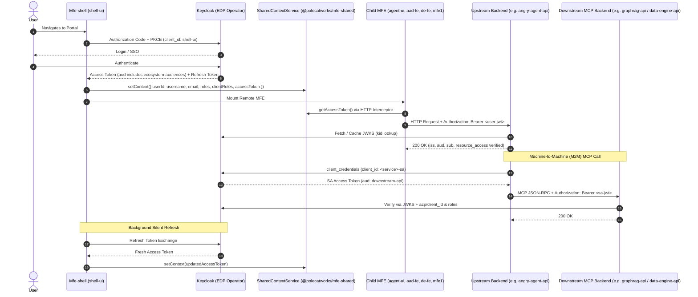

# Ecosystem Keycloak OIDC, Claims Distribution & Service Auth Pattern PRD

> [!IMPORTANT]
> **Canonical Ecosystem Reference**: This document is the **single source of truth** for Keycloak OIDC authentication, claims distribution, backend JWKS verification, RBAC, and Machine-to-Machine (M2M) service accounts across the entire PolecatWorks ecosystem (`Mfe-shell`, `Angry-agent`, `agent-as-data`, `Graphrag`, and `data-engine`).
>
> Service repositories maintain short, service-local addenda (client IDs, roles, custom claim namespaces, and endpoint RBAC matrices) that reference this canonical pattern rather than duplicating global auth architecture.

---

## 1. Overview & Non-Negotiable Principles

**Mfe-shell (`mfe-shell-container` and `@polecatworks/mfe-shared`)** acts as the single browser authentication authority for the PolecatWorks AI Portal, while every backend microservice acts as a fail-closed OAuth2/OIDC Resource Server.

This canonical pattern enforces five ecosystem-wide rules:

1. **Zero Fake / Dev-Only Auth**: Total elimination of client-controlled identity headers (`X-User-ID`, `default_user`, mock JWTs, or localStorage auth bypasses) across dev, staging, and production. Missing or invalid tokens **must** return `401 Unauthorized`; missing roles **must** return `403 Forbidden`.
2. **Single Browser OIDC Session (`shell-ui`)**: `Mfe-shell` executes Authorization Code Flow with PKCE via `angular-oauth2-oidc`, manages background silent token refresh, and broadcasts tokens/claims through `@polecatworks/mfe-shared` (`SharedContextService`). Federated child MFEs never implement their own login flows.
3. **Shared Audience Scope (`ecosystem-audiences`)**: A single Keycloak `KeycloakClientScope` (`ecosystem-audiences`) attaches `oidc-audience-mapper` protocol mappers for every backend resource server (`angry-agent-api`, `graphrag-api`, `data-engine-api`, `agent-as-data-api`) to user access tokens issued to `shell-ui`.
4. **Dynamic JWKS Verification**: Every backend microservice validates Bearer JWTs using Keycloak's OIDC discovery / JWKS endpoint (`/.well-known/openid-configuration` → `jwks_uri`) with TTL caching and `kid` rotation handling. Static PEM public keys are prohibited.
5. **Explicit M2M Service Accounts (`<service>-sa`)**: Backend-to-backend HTTP and MCP calls use OAuth2 `client_credentials` with a dedicated confidential `<service>-sa` client whose secret is injected via Kubernetes Secret / ExternalSecrets.

---

## 2. End-to-End Architecture Flow



---

## 3. Portal OIDC Client & Frontend Distribution Pattern (`Mfe-shell`)

### 3.1 Keycloak Portal Client & Scope (`fluxcd-dev/keycloak-ui.yaml`)
Defined via EPAM EDP Keycloak Operator CRDs (`v1.edp.epam.com/v1`):

- **`KeycloakClientScope: ecosystem-audiences`**:
  - `protocol: openid-connect`
  - Includes `oidc-audience-mapper` entries (`access.token.claim: "true"`, `introspection.token.claim: "true"`, `id.token.claim: "false"`) for:
    - `angry-agent-api`
    - `graphrag-api`
    - `data-engine-api`
    - `agent-as-data-api`
- **`KeycloakClient: shell-ui`**:
  - `public: true`, `standardFlowEnabled: true`, `advancedProtocolMappers: true`
  - `defaultClientScopes`: `web-origins`, `role_list`, `profile`, `roles`, `email`, `ecosystem-audiences`
  - `webOrigins`: `["+"]`
  - `redirectUris`: `https://ai.dev.polecatworks.com/*`, `http://localhost:4200/*`, `http://localhost:8080/*`, `https://aad.k8s/*`, `http://aad.k8s/*`, `https://agent-as-data.k8s/*`, `http://agent-as-data.k8s/*`, `https://ai.k8s/*`, `http://ai.k8s/*`

### 3.2 `@polecatworks/mfe-shared` Contract
`SharedContextService` exposes reactive observables and synchronous accessors to all federated child MFEs:

```typescript
export interface UserContext {
  userId: string;                        // Extracted from JWT 'sub'
  username: string;                      // Extracted from JWT 'preferred_username'
  email: string;                         // Extracted from JWT 'email'
  roles: string[];                       // Global realm roles
  clientRoles: Record<string, string[]>; // Map of clientId -> roles[]
  accessToken: string;                   // Active Bearer JWT
}
```

### 3.3 Child MFE HTTP Interceptor Pattern
Every federated child MFE (`agent-ui-container`, `aad-fe-container`, `de-fe-container`, `mfe1-container`):
1. Reads `SharedContextService.getAccessToken()` from `@polecatworks/mfe-shared`.
2. Attaches `Authorization: Bearer <token>` on all outbound `/api/*` and `/mcp` requests.
3. On `401 Unauthorized` (missing/expired token when silent refresh fails), emits an auth event back to `Mfe-shell` to trigger OIDC re-authentication—never constructs fake JWTs or falls back to local login screens.

---

## 4. Standard Backend Service Auth Pattern (All Ecosystem Backends)

All Rust/Axum ecosystem backends (`Angry-agent`, `agent-as-data`, `Graphrag`, `data-engine`) implement the same fail-closed auth middleware contract:

### 4.1 Token Verification Rules
1. **JWKS Discovery & Caching**: Fetch JWKS from Keycloak (`jwks_uri`), cache keys in memory with TTL, and refresh on unknown `kid` (key rotation).
2. **Issuer & Audience Check**: Verify `iss` matches the configured realm issuer and `aud` contains the service's own `<service>-api` client ID.
3. **Canonical Identity**: Extract `user_id = claims.sub`. Never read `X-User-ID` or fall back to a default user.
4. **Client-Scoped RBAC**: Extract roles from `claims.resource_access["<service>-api"].roles`. Reject missing roles with `403 Forbidden`.
5. **Custom Domain Claims**: Each service may read its own top-level namespace (e.g., `angry_agent`, `agent_as_data`, `graphrag`, `data_engine`) for quotas, allowed domains, or compute tiers.
6. **Health Endpoints**: Only liveness/readiness probes (`/health`, `/hams/*`) are exempt from Bearer verification; all `/api/*` and `/mcp` routes require a valid token.

### 4.2 Machine-to-Machine (M2M) Pattern
- Outbound service-to-service HTTP/MCP callers authenticate via OAuth2 `client_credentials` using their confidential `<service>-sa` client and Kubernetes Secret credentials (`<service>-sa-credentials`).
- Tokens are cached until shortly before `exp` and refreshed automatically.
- Receiving services validate M2M tokens through the exact same JWKS verifier, checking `aud`, client roles, and `azp` / `client_id` for authorized ecosystem callers.

### 4.3 Standard Configuration Schema
All backend services expose auth configuration through their centralized fail-fast `AppConfig` (loaded from YAML + `<PREFIX>__AUTH__*` env vars, never via direct `std::env::var` calls):
- `auth.issuer_url` (required, non-empty URL)
- `auth.jwks_url` (required, non-empty URL or derived via OIDC discovery)
- `auth.audience` (required, matches `<service>-api`)
- `auth.jwks_cache_ttl_secs` (required, positive integer)
- Optional `auth.service_account` block (`token_url`, `client_id`, `client_secret`) for services making outbound M2M calls.

---

## 5. Ecosystem Service Client Registry

Each service repository maintains its own local PRD addendum specifying its exact RBAC matrix and custom claims schema:

| Repository | API Client ID (`aud`) | Service Account Client ID | Custom Claims Namespace | Client Roles | Local PRD Addendum |
| :--- | :--- | :--- | :--- | :--- | :--- |
| **`Mfe-shell`** | `shell-ui` (Public OIDC) | — | — | Realm + client roles via `ecosystem-audiences` | *(This canonical PRD)* |
| **`Angry-agent`** | `angry-agent-api` | `angry-agent-sa` | `angry_agent` | `agent:execute`, `agent:create`, `agent:admin` | [`Angry-agent` Service Auth Addendum](https://github.com/PolecatWorks/Angry-agent/blob/main/spec/prds/service-claims-and-keycloak-auth-prd.md) |
| **`agent-as-data`** | `agent-as-data-api` | `agent-as-data-sa` | `agent_as_data` | `agent:read`, `agent:author`, `agent:publish`, `governance:admin` | [`agent-as-data` Service Auth Addendum](https://github.com/PolecatWorks/agent-as-data/blob/main/spec/prds/keycloak-claims-and-service-auth-prd.md) |
| **`Graphrag`** | `graphrag-api` | `graphrag-sa` | `graphrag` | `graph:read`, `graph:write`, `graph:admin` | [`Graphrag` Service Auth Addendum](https://github.com/PolecatWorks/Graphrag/blob/main/spec/prds/keycloak-claims-and-service-auth-prd.md) |
| **`data-engine`** | `data-engine-api` | `data-engine-sa` | `data_engine` | `profile:run`, `query:run`, `compute:execute`, `dataset:admin` | [`data-engine` Service Auth Addendum](https://github.com/PolecatWorks/data-engine/blob/main/spec/prds/keycloak-claims-and-service-auth-prd.md) |
