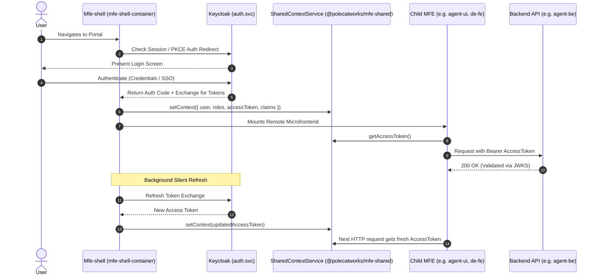

# MFE Shell Keycloak OIDC Authentication & Client Claims Distribution PRD

## Overview
This PRD defines how **Mfe-shell (`mfe-shell-container` and `@polecatworks/mfe-shared`)** acts as the single authentication authority for the entire PolecatWorks ecosystem.

It specifies:
1. **Public OIDC Client Integration**: Running Authorization Code flow with PKCE using `angular-oauth2-oidc` against Keycloak client `mfe-shell`.
2. **Audience & Client Scope Negotiation**: Requesting backend client scopes (`angry-agent-api`, `graphrag-api`, `data-engine-api`, `agent-as-data-api`) so that minted user JWTs carry the required audience targets and client role blocks.
3. **Reactive Token Lifecycle in `@polecatworks/mfe-shared`**: Silent refresh of access tokens and broadcast via `SharedContextService` to all mounted federated microfrontends.
4. **Zero Mock/Fake Fallback Policy**: Enforcing genuine OIDC login across development, staging, and production clusters.

---

## Architecture Flow



---

## Specification Details

### 1. Keycloak Client Configuration (`KeycloakClient: mfe-shell`)
- **Type**: Public client (`publicClient: true`)
- **Protocol**: OpenID Connect (OIDC)
- **Grant Types**: Authorization Code with PKCE (`standardFlowEnabled: true`, `pkceCodeChallengeMethod: "S256"`)
- **Redirect URIs**:
  - `https://ai.dev.polecatworks.com/*`
  - `http://localhost:4200/*`
- **Client Scopes**:
  - `openid`, `profile`, `email`
  - `angry-agent-api-scope`
  - `data-engine-api-scope`
  - `graphrag-api-scope`
  - `agent-as-data-api-scope`

### 2. `@polecatworks/mfe-shared` Integration Contract
`SharedContextService` provides reactive observables and synchronous accessors:
```typescript
export interface UserContext {
  userId: string;          // Extracted from 'sub'
  username: string;        // 'preferred_username'
  email: string;           // 'email'
  roles: string[];         // Global realm roles
  clientRoles: Record<string, string[]>; // Map of clientId -> roles[]
  accessToken: string;     // Active Bearer JWT
}
```
All federated child MFEs (`agent-ui`, `de-fe`, `mfe1`, `agent-as-data`) must query `SharedContextService` rather than establishing their own auth flows or using local mock credentials.
