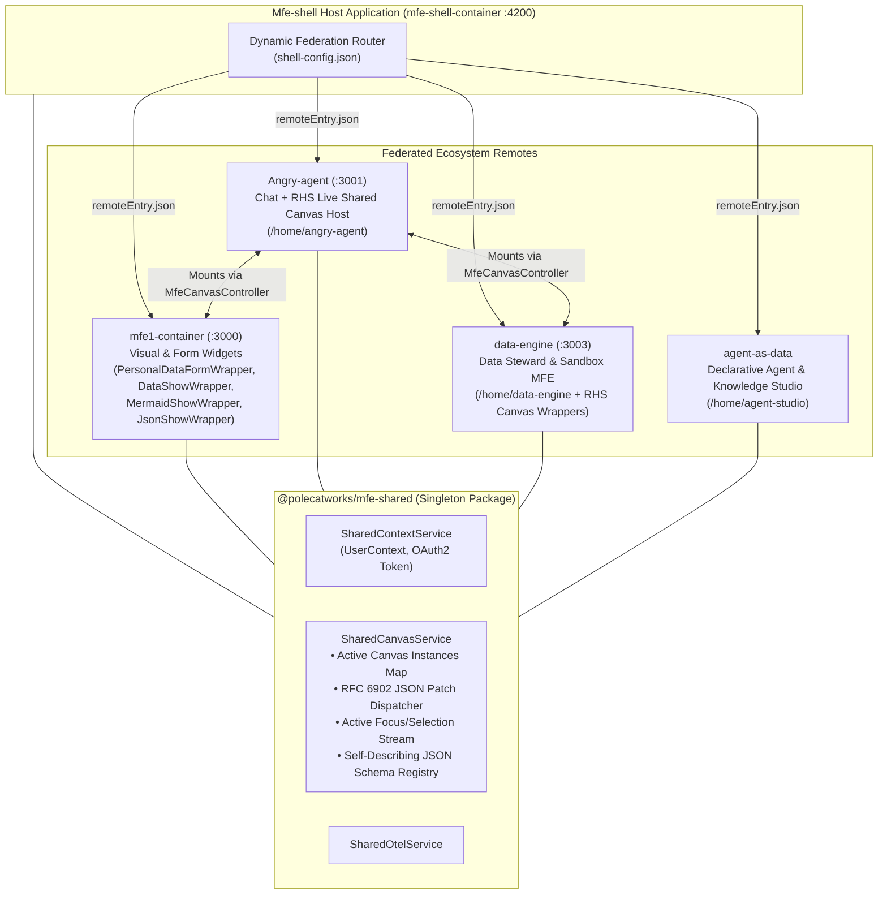

# Shared Canvas Protocol (`@polecatworks/mfe-shared`) & Ecosystem Federation PRD

## Overview
This PRD defines the evolution of **MFE-Shell (`mfe-shell-container`, `@polecatworks/mfe-shared`, and `mfe1-container`)** to serve as:
1. **The Unified Enterprise AI Portal Host (`mfe-shell-container`)**: Dynamically federating [`Angry-agent`](https://github.com/PolecatWorks/Angry-agent) (`/home/angry-agent`), [`data-engine`](https://github.com/PolecatWorks/data-engine) (`/home/data-engine`), [`agent-as-data`](https://github.com/PolecatWorks/agent-as-data) (`/home/agent-studio`), and `mfe1` via `shell-config.json` and Istio `VirtualService` routing on `ai.k8s`.
2. **The Canonical Shared Canvas State & Lifecycle Contract (`@polecatworks/mfe-shared`)**: Providing `SharedCanvasService` and the framework-agnostic `MfeCanvasController` interface so any MFE form or visualization mounted on the right-hand side (RHS) of a chat interface supports live bidirectional human + AI co-editing without losing DOM focus or unsaved user input.
3. **Live-Patchable Visual & Form Remotes (`mfe1-container`)**: Upgrading `PersonalDataFormWrapper`, `DataShowWrapper`, `MermaidShowWrapper`, `JsonShowWrapper`, `MarkdownShowWrapper`, and `TextShowWrapper` to return full `MfeCanvasController` instances.

---

## Ecosystem Federation & Shared Canvas Architecture



---

## Core Capabilities & Requirements

### 1. `SharedCanvasService` & `MfeCanvasController` in `@polecatworks/mfe-shared`
Located in `mfe-shell-container/projects/mfe-shared/src/lib/shared-canvas.service.ts` and exported from `public-api.ts`:

```typescript
export interface JsonPatchOp {
  op: 'add' | 'replace' | 'remove';
  path: string;
  value?: any;
}

export interface AiFieldAttribution {
  path: string;
  source: 'ai' | 'user';
  confidence?: number;
  rationale?: string;
  epistemicStatus?: 'hypothesized' | 'empirically_tested' | 'verified' | 'rejected';
}

export interface CanvasSelection {
  canvasId: string;
  path: string;
  id?: string;
  label: string;
  context?: any;
}

export interface MfeMountProps<T = any> {
  id?: string;
  title?: string;
  name?: string;
  description?: string;
  content?: T;
  initialState?: T;
  onStateChange?: (state: T, patches: JsonPatchOp[]) => void;
  onSelectionChange?: (selection: CanvasSelection | null) => void;
  onAction?: (actionName: string, payload: any) => void;
}

export interface MfeCanvasController<T = any> {
  /** Apply RFC 6902 JSON Patch array or partial object in-place without destroying DOM */
  applyPatch(patches: JsonPatchOp[] | Partial<T>, attributions?: AiFieldAttribution[]): void;
  /** Retrieve live unsubmitted state from the mounted component */
  getState(): T;
  /** Retrieve Draft-07 JSON Schema of the component's state and supported actions */
  getSchema(): Record<string, any>;
  /** Destroy the mounted component and release resources */
  unmount(): void;
}
```

#### Responsibilities of `SharedCanvasService`:
1. **Live Instance Registry**: Tracks all mounted `MfeCanvasController` instances by `canvasId` (`viz.id`).
2. **Bidirectional State & Patch Stream (`canvasState$`)**: Emits whenever either the human user (`onStateChange`) or the AI agent (`applyPatch`) mutates a mounted MFE's state.
3. **Active Focus / Selection Tracking (`activeSelection$`)**: Tracks which field, table row, or graph node the user currently has focused in the RHS MFE so the LHS chat interface can display a focus pill (`🎯 Focused: <label>`) and include it in LLM context.
4. **Active-Focus Lock Helper**: Provides a utility for reactive forms that defers incoming AI patches targeting a control path where the user currently holds keyboard focus (`document.activeElement`), preventing mid-keystroke cursor jumps.

---

### 2. Upgrading `mfe1-container` Wrappers (`PersonalDataFormWrapper`, `DataShowWrapper`, `MermaidShowWrapper`, `JsonShowWrapper`)
All wrappers in `mfe1-container` are upgraded from returning a bare `() => unmount(container)` function to returning a full **`MfeCanvasController`** object (while remaining callable/compatible with legacy hosts):
- **`PersonalDataFormWrapper` (`mfe1-container/src/app/personal-data-form/personal-data-form-wrapper.ts`)**:
  - Subscribes to `componentRef.instance.form.valueChanges` (debounced) to emit `props.onStateChange(form.getRawValue(), patches)` silently as the user types.
  - Tracks focus on each `mat-form-field` input to emit `props.onSelectionChange({ path: '/firstName', label: 'First Name' })`.
  - Implements `applyPatch(patches, attributions)` by calling `form.patchValue(..., { emitEvent: false })` and `componentRef.changeDetectorRef.detectChanges()` in place—never destroying or recreating the Angular `ApplicationRef` or losing user cursor focus.
  - Implements `getSchema()` returning the Draft-07 JSON Schema for `{ firstName, lastName, email, phoneNumber, address }`.
  - Displays visual AI-attribution indicators when fields are populated or modified by the AI.

---

### 3. Ecosystem Registration in `shell-config.json` & `fluxcd-dev/virtualservice.yaml`
`mfe-shell-container/public/assets/contents/shell-config.json` and `fluxcd-dev/virtualservice.yaml` support routing across all federated remotes in the ecosystem:
- `mfe1` (`:3000` / `/mfe/mfe1`)
- `angry-agent` (`:3001` / `/mfe/angry-agent`)
- `data-engine` (`:3003` / `/mfe/data-engine`)
- `agent-as-data` (`:3004` / `/mfe/agent-as-data`)
