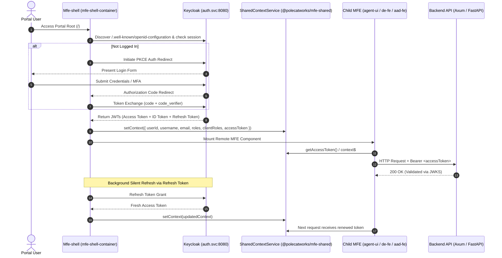

# Spec 03: Keycloak OIDC Authentication, Audience Scopes & Claims Distribution

- **Status**: `draft`
- **Derived From**: [keycloak-oidc-and-claims-distribution-prd.md](../prds/keycloak-oidc-and-claims-distribution-prd.md)
- **Dependencies**: [01-shared-canvas-service-spec.md](./01-shared-canvas-service-spec.md), [02-mfe1-canvas-wrappers-and-shell-config-spec.md](./02-mfe1-canvas-wrappers-and-shell-config-spec.md)

---

## 1. Objective

Formally specify and test the end-to-end OIDC authentication, token lifecycle, and claims distribution architecture in `Mfe-shell`:
1. **Public Keycloak Client Integration (`shell-ui`)**: Execute Authorization Code Flow with PKCE using `angular-oauth2-oidc`.
2. **Ecosystem Audience Scopes**: Guarantee tokens minted by Keycloak contain audiences for all backend microservices (`angry-agent-api`, `graphrag-api`, `data-engine-api`, `agent-as-data-api`) via `ecosystem-audiences` scope.
3. **Ecosystem Realm Groups Mapping**: Verify and surface roles granted via `DataAgentAdmins` and `DataAgentUsers` realm groups.
4. **Reactive Token Lifecycle in `@polecatworks/mfe-shared`**: Silent token renewal and reactive propagation across mounted child MFEs via `SharedContextService`.
5. **Zero Mock/Fake Auth Policy**: Enforce authenticated user sessions across all portal views with zero fallback mock identities.

---

## 2. Authentication & Claims Architecture



---

## 3. Detailed Component Contracts

### 3.1 Keycloak Client & Scope Definitions (`fluxcd-dev/`)
- **Client `shell-ui`** (`fluxcd-dev/keycloak-ui.yaml`):
  - `public: true`, `standardFlowEnabled: true`, `pkceCodeChallengeMethod: "S256"`
  - `defaultClientScopes`: includes `ecosystem-audiences`, `profile`, `email`, `roles`
- **ClientScope `ecosystem-audiences`**:
  - Adds audience mappers for `angry-agent-api`, `graphrag-api`, `data-engine-api`, `agent-as-data-api`
- **Realm Groups `data-agent-admins` & `data-agent-users`** (`fluxcd-dev/keycloak-service-capture.yaml`):
  - Map complete matrix of client roles across all 4 APIs.

### 3.2 `mfe-shell-container` Auth Configuration (`src/app/auth.config.ts`)
```typescript
import { AuthConfig } from 'angular-oauth2-oidc';

export function getAuthConfig(issuer: string, clientId: string): AuthConfig {
  return {
    issuer,
    clientId,
    responseType: 'code',
    scope: 'openid profile email ecosystem-audiences',
    showDebugInformation: false,
    sessionChecksEnabled: true,
    useSilentRefresh: true,
    timeoutFactor: 0.75,
    clearHashAfterLogin: true
  };
}
```

### 3.3 `SharedContextService` (`@polecatworks/mfe-shared`)
```typescript
export interface UserContext {
  userId: string;
  username: string;
  email: string;
  roles: string[];
  clientRoles: Record<string, string[]>;
  accessToken: string;
}

export class SharedContextService {
  private context$ = new BehaviorSubject<UserContext | null>(null);

  setContext(context: UserContext): void;
  getContext(): UserContext | null;
  getAccessToken(): string | null;
  hasRole(clientId: string, role: string): boolean;
  isDataAgentAdmin(): boolean;
}
```

---

## 4. Test Strategy

### 4.1 Unit Tests (`mfe-shell-container` & `@polecatworks/mfe-shared`)
- **`shared-context.service.spec.ts`**:
  - Verify context initialization, token retrieval, and reactive observable updates.
  - Verify `hasRole(clientId, role)` across multiple client role definitions.
  - Verify `isDataAgentAdmin()` correctly returns true when `data-agent-admins` roles are present.
- **`app.spec.ts`**:
  - Verify OAuthService startup flow and propagation to `SharedContextService`.

### 4.2 Integration Tests (`integration-tests/`)
- Robot Framework tests asserting that unauthenticated requests to portal trigger login flow.
- Verified JWT tokens minted by Keycloak contain all 4 audiences (`aud`) and correct `resource_access` blocks.
